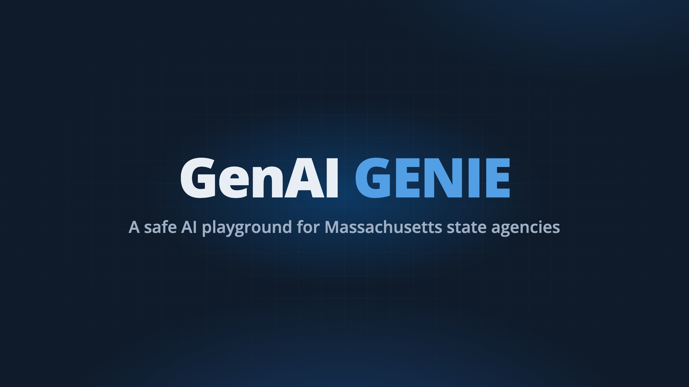
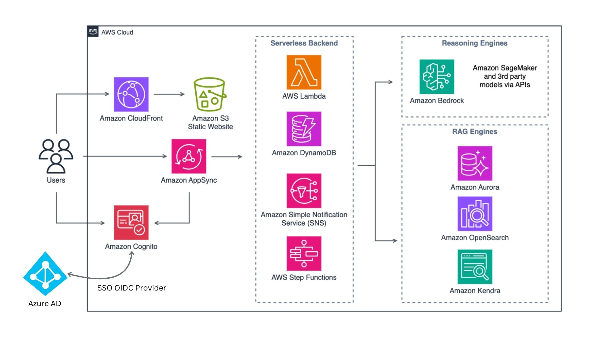

# EOTSS GenAI GENIE

*Click the image to watch a 23-second tour.*

## Overview

The GenAI GENIE is designed to empower Massachusetts state agency employees with varying technical proficiencies to effectively utilize AI technologies. It addresses the challenges of accessibility, system integration, and ethical concerns while enhancing operational efficiency, service delivery, and innovation within public sector operations.

## GENIE Features

### Chatbot Playground

The Chatbot Playground provides a safe environment for users to experiment with different Large Language Models (LLMs). Users can test various models, customize parameters (e.g., TopP, temperature), and observe how different configurations affect model responses. This feature is ideal for gaining hands-on experience with AI models and understanding their capabilities.

### Multi-Chat Playground

The Multi-Chat Playground enhances the Chatbot Playground by allowing users to query 2-4 models simultaneously. This feature facilitates efficient comparison of results on a single screen, helping users to evaluate and select the best model for their specific needs.

### Smart Model

The Smart Model feature enhances AI responses by leveraging advanced algorithms and a dedicated context management system. It automatically decides which model to use based on various factors such as task requirements, cost, efficiency, token size, and model capabilities. This ensures that beginner users can focus on their tasks without needing in-depth knowledge of model specifications.

### Tasks

The Task section offers a pre-filled prompt system to assist users in completing specific tasks, enhancing user experience and productivity. It automates prompt engineering, enabling users to concentrate on tasks without the need to craft detailed prompts.

Built-in tasks include Summarize, Translate, Create a Meeting Agenda, Email Composition Assistant, Draft a Memo and Daily Planning.

### Workspaces

Workspaces function like a file system within the AI GENIE, allowing users to create and manage multiple private workspaces. Each workspace can be configured with different Retrieval-Augmented Generation (RAG) engines, such as Aurora, OpenSearch, and Kendra. Users can upload multiple documents to their workspaces and perform queries using the RAG setup.

Workspaces allow users to upload documents to genie. This can be accessed through the side panel of GENIE ("Document Upload") or through the Chatbot message input, where there is a button on the left hand side of the input panel. This will automatically create a workspace in Kendra for the user, where they can upload a document and be redirected to the chatbot to begin interaction with the uploaded document.

### Retrieval-Augmented Generation (RAG)

The RAG setup allows users to upload documents and perform search queries, ensuring accurate and relevant information retrieval tailored to user needs. This feature enhances the ability to find and utilize critical information from large datasets efficiently.

## Architecture

For more information, visit the [AWS GenAI LLM Chatbot](https://aws-samples.github.io/aws-genai-llm-chatbot/).

## Models and running cost

Every model is called through the Amazon Bedrock Converse API. The list lives in `CURATED_BEDROCK_MODELS` in `lib/shared/layers/python-sdk/python/genai_core/models.py`: Claude Haiku 5.5, Sonnet 5.5 and Opus 5.5, Amazon Nova 2 Lite and Nova Pro, Llama 4 Maverick, Mistral Large 3, gpt-oss 120B, DeepSeek V3.2, Qwen3 Next 80B, GPT-6.2 Sol and Grok 4.7. Claude and Nova models accept images. The Smart Model routes each prompt to one of these with Claude Haiku 5.5.

With RAG, SageMaker models and the private website turned off (the default), the stack creates no VPC, NAT gateway or interface endpoints, so an idle deployment costs about a dollar a month. Model use is billed per request. Turning on any of those features brings the VPC back.

## Deployment Guide

See the [deployment guide](docs/guide/deploy.md).

## Developers

- [Sarah Klute](https://www.linkedin.com/in/sarahklute/)
- [Alayna Schwarzer](https://www.linkedin.com/in/alayna-schwarzer/)
- [Dhruv Kamalesh Kumar](https://www.linkedin.com/in/dhruvkamaleshkumar)
