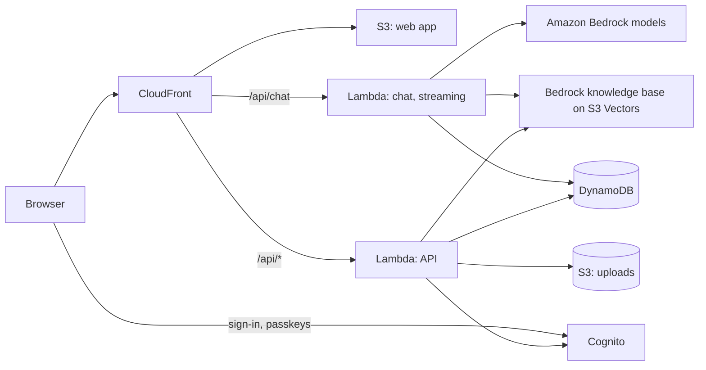

# Genie

Genie is an open-source, multi-model AI chat app that you deploy to your own AWS account. It supports file attachments, side-by-side model comparison, prompt templates, and question answering over your own documents with citations. Admins manage users, models and settings from the app.

It is fully serverless, so an idle deployment costs a few cents a month.

## What it does

- **Chat with current models** through Amazon Bedrock: Claude, GPT, Nova, Mistral, DeepSeek, Qwen, Grok and others. Admins choose which models are available.
- **Full-length answers and full conversations.** Replies can use each model's full output length, and the whole conversation is sent every turn. Nothing is quietly cut short; if a model can't fit the history, Genie says so.
- **Attach files and images.** PDFs, Word documents, spreadsheets and images. Models that can't read files directly get the extracted text, so attachments work with every model.
- **Think harder** on models that support extended reasoning, with the reasoning shown in a collapsible section.
- **Compare** two or three models on the same prompt, then continue with the best answer in a normal chat.
- **Templates** for common work: summaries, plain-language rewrites, emails, agendas, translations.
- **Document workspaces**, personal or shared, searched with Bedrock knowledge bases. Answers cite the passages they used.
- **Easy sign-in.** Passkeys (Face ID, Touch ID, security keys), passwords, and optional emailed codes. Self sign-up can be off, limited to your email domains, or held for admin approval.
- **Admin console.** People and roles, approvals, the model catalog with health tests, templates, settings and daily limits, usage by model and person, a feedback queue and an audit log.
- **Accessible.** Built to WCAG 2.2 AA, with light and dark themes and a designed phone layout.

## How it works



There is no VPC, NAT gateway or always-on server. See [ARCHITECTURE.md](ARCHITECTURE.md) for the full design: data model, API, streaming format, limits and naming rules.

## Get started

```bash
npm run install:all
npm run dev:mock          # the web app with a built-in mock backend, no AWS needed
```

To deploy to AWS, follow [docs/deploy.md](docs/deploy.md). In short:

```bash
npx cdk bootstrap aws://<account>/us-east-1
npm run deploy
./scripts/create-user.sh you@example.org --admin genie-dev
```

## Repository

| Path | What it holds |
|---|---|
| `web/` | React 19 app: Vite, Tailwind CSS 4, React Aria Components, TanStack Query |
| `backend/` | Node.js 22 Lambdas: API router, streaming chat, Cognito triggers |
| `infra/` | AWS CDK app that deploys the `genie-{env}` stack |
| `design/` | Design spec, tokens, logo and the clickable prototype |
| `docs/` | Deploy guide, admin guide, operations notes |
| `scripts/` | Operator scripts |

## Checks

```bash
npm run check    # typecheck, lint, tests and build across all packages
npm run synth    # synthesize the CloudFormation template
```

Every AWS resource is named `genie-{env}-*` and tagged `Project`, `Environment`, `ManagedBy` and `Owner`; an infrastructure test fails the build if any resource breaks that rule.

## Docs

- [Deploy](docs/deploy.md)
- [Admin guide](docs/admin-guide.md)
- [Operations](docs/operations.md)
- [Architecture](ARCHITECTURE.md)
- [Design](design/DESIGN.md)
- [Contributing](CONTRIBUTING.md)

## License

[MIT](LICENSE) © 2026 The Burnes Center
