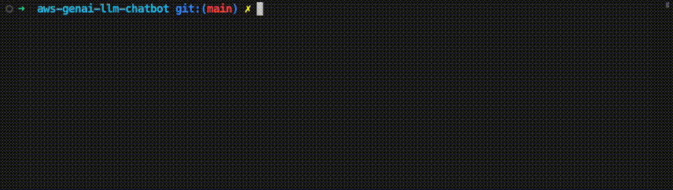

# Deploy

## Environment setup

### Local deployment

Verify that your environment satisfies the following prerequisites:

You have:

1. An [AWS account](https://aws.amazon.com/premiumsupport/knowledge-center/create-and-activate-aws-account/)
2. `AdministratorAccess` policy granted to your AWS account (for production, we recommend restricting access as needed)
3. Both console and programmatic access
4. [NodeJS 18 or newer](https://nodejs.org/en/download/) installed

5. [AWS CLI](https://aws.amazon.com/cli/) installed and configured to use with your AWS account
6. [Typescript 3.8+](https://www.typescriptlang.org/download) installed
7. [AWS CDK CLI](https://docs.aws.amazon.com/cdk/latest/guide/getting_started.html) installed
8. [Docker](https://docs.docker.com/get-docker/) installed
   - N.B. [`buildx`](https://github.com/docker/buildx) is also required. For Windows and macOS `buildx` [is included](https://github.com/docker/buildx#windows-and-macos) in [Docker Desktop](https://docs.docker.com/desktop/)
9. [Python 3+](https://www.python.org/downloads/) installed

## Deployment

1. Clone the repository

```bash
git clone https://github.com/The-Burnes-Center/GenAI-GENIE
```

2. Move into the cloned repository

```bash
cd GenAI-GENIE
```

<a id="deployment-dependencies-installation"></a> 3. Install the project dependencies and build the project by running this command

```bash
npm install && npm run build
```

4. Once done, run the magic-config CLI to help you set up the solution with the features you care most:

```bash
npm run config
```

You'll be prompted to configure the different aspects of the solution, such as:

- The LLMs or MLMs to enable (we support all models provided by Bedrock along with SageMaker hosted Idefics, FalconLite, Mistral and more to come)
- Setup of the RAG system: engine selection (i.e. Aurora w/ pgvector, OpenSearch, Kendra..) embeddings selection and more to come.
- Private Chatbot: Limit accessibility to website and backend to VPC.

When done, answer `Y` to create or update your configuration.



Your configuration is now stored under `bin/config.json`. You can re-run the magic-config command as needed to update your `config.json`

5. (Optional) Bootstrap AWS CDK on the target account and region

> **Note**: This is required if you have never used AWS CDK on this account and region combination. ([More information on CDK bootstrapping](https://docs.aws.amazon.com/cdk/latest/guide/cli.html#cli-bootstrap)).

```bash
npx cdk bootstrap aws://{targetAccountId}/{targetRegion}
```

You can now deploy by running:

```bash
npx cdk deploy
```

> **Note**: This step duration can vary greatly, depending on the Constructs you are deploying.

You can view the progress of your CDK deployment in the [CloudFormation console](https://console.aws.amazon.com/cloudformation/home) in the selected region.

6. Once deployed, take note of the `User Interface`, `User Pool` and, if you want to interact with [3P models providers](#3p-models-providers), the `Secret` that will, eventually, hold the various `API_KEYS` should you want to experiment with 3P providers.

```bash
...
Outputs:
GenAIChatBotStack.UserInterfaceUserInterfaceDomanNameXXXXXXXX = dxxxxxxxxxxxxx.cloudfront.net
GenAIChatBotStack.AuthenticationUserPoolLinkXXXXX = https://xxxxx.console.aws.amazon.com/cognito/v2/idp/user-pools/xxxxx_XXXXX/users?region=xxxxx
GenAIChatBotStack.ApiKeysSecretNameXXXX = ApiKeysSecretName-xxxxxx
...
```

7. Create a user to sign in with. Self sign-up is off, so users are created from the command line:

```bash
./scripts/create-user.sh demo@example.org
```

The script finds the user pool from the stack outputs, prompts for a password (or reads `GENIE_USER_PASSWORD`), and sets it as permanent so there is no forced reset on first sign-in. Re-run it to reset a password. Pass the stack name as a second argument if you set a `prefix` in the config.

8. Open the `User Interface` URL from the outputs above (i.e. `dxxxxxxxxxxxxx.cloudfront.net`) and sign in with that email and password.

## Run user interface locally

See instructions in the README file of the [`lib/user-interface/react-app`](../../lib/user-interface/react-app/README.md) folder.

## Using Kendra with a non-english index

If you're using Kendra with an index in a language other than English, you will need to make some code modifications.

You'll need to modify the filters in the file `lib/shared/layers/python-sdk/python/genai_core/kendra/query.py`.

Example for french :

```python
    if kendra_index_external or kendra_use_all_data:
        result = kendra.retrieve(
            IndexId=kendra_index_id,
            QueryText=query,
            PageSize=limit,
            PageNumber=1,
            AttributeFilter={'AndAllFilters': [{"EqualsTo": {"Key": "_language_code","Value": {"StringValue": "fr"}}}]}
        )
    else:
        result = kendra.retrieve(
            IndexId=kendra_index_id,
            QueryText=query,
            PageSize=limit,
            PageNumber=1,
            AttributeFilter={'AndAllFilters':
                [
                    {"EqualsTo": {"Key": "_language_code","Value": {"StringValue": "fr"}}},
                    {"EqualsTo": {"Key": "workspace_id","Value": {"StringValue": workspace_id}}}
                ]
            }
        )
```

Please note: If these adjustments are made post-deployment, it's essential to rebuild and redeploy. If done prior to deployment, you can proceed with the walkthrough as usual.

```bash
npm install && npm run build
npx cdk deploy
```

## Clean up

You can remove the stacks and all the associated resources created in your AWS account by running the following command:

```bash
npx cdk destroy
```

> **Note**: Depending on which resources have been deployed. Destroying the stack might take a while, up to 45m. If the deletion fails multiple times, please manually delete the remaining stack's ENIs; you can filter ENIs by VPC/Subnet/etc using the search bar [here](https://console.aws.amazon.com/ec2/home#NIC) in the AWS console) and re-attempt a stack deletion.
